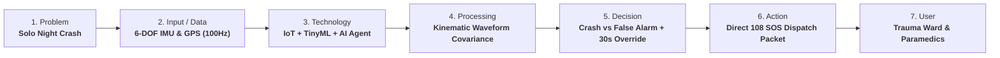

# AegisRide: Golden-Hour Accident Detection & Autonomous Triage
> **Topic #06:** Two-Wheeler Crash & Golden-Hour Emergency Response  
> **Prepared for:** System Design Defense & 60-Second Pitch Evaluation  
> **Interactive Live App:** [http://localhost:4173](http://localhost:4173)

---

## 1. Sharpen Your Problem *(Slide 5)*

| Dimension | Our Solution's Sharpened Focus |
| :--- | :--- |
| **1. WHO is affected?** | **Solo two-wheeler commuters and gig-economy delivery riders** (Swiggy, Zomato, Zepto) travelling without a pillion passenger. |
| **2. WHERE / WHEN?** | **Between 11:00 PM and 5:00 AM** on unlit bypass roads, elevated flyovers, and peri-urban ring roads with near-zero pedestrians or passing traffic. |
| **3. WHAT GOES WRONG?** | Following high-G impact, the rider is concussed, unconscious, or pinned under the motorcycle. Incapacitated and unable to dial for help, the medical **"Golden Hour"** (the initial 60 minutes where trauma care prevents death) expires before any bystander notices them. |
| **What does it cost?** | Over **65,000 preventable two-wheeler deaths** annually in India alone due to delayed reporting (reporting delay averages 45–90 minutes in solo night crashes). |

---

## 2. The Decision Matrix *(Slide 2)*

> **Core Rubric Rule:** *"Using all four technologies earns no bonus. Using the right ones, and defending why, earns marks."*

| Technology | Used? | Specific Job in YOUR System | If NOT used: Why not? |
| :--- | :---: | :--- | :--- |
| **IoT** | **YES** | Multi-axis 6-DOF Inertial Measurement Unit (IMU) + GNSS/GPS module mounted on the bike chassis/helmet. Samples continuous tri-axial acceleration ($X, Y, Z$), roll/pitch rate, and vehicle speed at 100 Hz. | — |
| **ML** | **YES** | Edge TinyML classifier (Random Forest / 1D-CNN) running on a low-power microcontroller. Analyzes 400ms temporal waveforms to distinguish actual crash signatures from false alarms (potholes, speed bumps, dropped phone/helmet). | — |
| **NLP** | **NO** | *(Deliberately Excluded)* | **1. Unconscious victims cannot speak:** In severe trauma, victims are incapacitated or concussed. **2. Severe acoustic noise:** Wind shear and exhaust noise (>85 dB at 60 km/h) make speech recognition fail. **3. Physics is vector math:** Kinematics is acceleration ($m/s^2$) and angular rate ($rad/s$), not natural language. |
| **AI** | **YES** | Autonomous Triage & Escalation Agent: Coordinates a progressive 30-second haptic/acoustic countdown; if uncancelled by the rider, it synthesizes an emergency trauma packet and executes direct CAD dispatch to the 108 trauma network. | — |

---

## 3. The 7-Step System Flow *(Slide 3)*

1. **Problem:** Solo night riders crash in unlit areas and bleed out during the Golden Hour without anyone knowing.
2. **Input / Data:** 3-axis acceleration vectors ($A_x, A_y, A_z$), gyroscopic roll/pitch angles, and GPS coordinates sampled at 100 Hz.
3. **Technology:** **IoT** gathers telemetry; **ML** filters out false drops; **AI** orchestrates autonomous emergency triage. (*NLP rejected*).
4. **Processing:** On-edge TinyML model evaluates sudden deceleration ($\Delta V > 35\text{ km/h}$ in $<200\text{ms}$), angular roll tilt ($>65^\circ$), and multi-axis impulse.
5. **Decision:** Is it a confirmed crash? Did the rider fail to cancel the 30-second escalating alarm?
6. **Action:** Broadcasts encrypted SOS telemetry packet with live GPS coordinates, trauma severity index, and vehicle ID to emergency dispatch.
7. **User:** Hospital Trauma ICU, 108 Emergency Ambulance Dispatcher, and rider's registered emergency contacts.

---

## 4. Complete Slide 12 Stress-Test Matrix (All 4 Pillars & 9 Questions)

### Pillar I: Data
* **Q1. What data does it need?**
  * Continuous tri-axial linear acceleration ($A_x, A_y, A_z$ in $m/s^2$ / G-force).
  * Tri-axial angular velocity (roll, pitch, yaw in $^\circ/s$).
  * High-precision GNSS/GPS coordinates (latitude, longitude, ground speed $\text{km/h}$, timestamp).
  * Static user profile (stored locally): Blood group, vehicle registration, and emergency contacts.
* **Q2. Where does it come from?**
  * Hardware 6-DOF IMU (MPU-6050 / ST LSM6DSOX) mounted securely to the bike chassis or integrated smart helmet, communicating via I2C at 100 Hz.
  * Dedicated GNSS receiver chip with active ceramic patch antenna.

---

### Pillar II: Intelligence
* **Q3. What does it decide or predict?**
  * **Crash Probability ($P > 0.92$):** Classifies multi-axis impact trajectories to differentiate genuine collisions from non-fatal disturbances (potholes, drops, curbs).
  * **Trauma Severity Score (TSS):** Predicts injury severity (Low / Moderate / Code-Red Severe) from $\Delta V$ deceleration and resting tilt angle to pre-notify trauma surgeons.
* **Q4. What happens next?**
  * Triggers an urgent 30-second escalating haptic and audible buzzer countdown on the vehicle handlebar/phone.
  * If uncancelled by countdown expiry, the autonomous AI agent packages the SOS payload, locates the nearest emergency trauma center via CAD API, and dispatches an ambulance dispatch request.

---

### Pillar III: Limitations & Failure Modes
* **Q5. What could go wrong?**
  * **Zero 4G/5G Cellular Coverage on Highway:** The system immediately triggers a 2-tier fallback:
    1. Secondary Fallback: Compressed 2G GSM SMS / USSD telemetry burst (which works on even 1-bar signal).
    2. Local Beacon: 110dB piezo siren and high-frequency hazard strobe lights to alert passing night motorists.
  * **Hardware/Battery Severed on Violent Collision:** Mitigated by onboard supercapacitor / backup coin battery ensuring 60 seconds of post-impact power to complete the emergency telemetry burst.
* **Q6. What if the data is wrong? (Sensor Glitch or Drift)**
  * Mitigated by Kalman filtering and multi-sensor plausibility checks. If GPS reports 100 km/h but IMU reports 0G vibration, the anomaly is flagged. A crash requires cross-validation across both linear deceleration AND angular gyroscopic inversion.
* **Q7. What if the prediction is wrong?**
  * **False Positive:** Prevented from reaching emergency services by the mandatory 30-second local override window. Conscious riders easily cancel with one tap.
  * **False Negative:** Mitigated by hard-coded kinetic fail-safes. If peak deceleration $>6G$ AND resting roll $>75^\circ$, the system triggers the 30s countdown regardless of ML feature ambiguity.

---

### Pillar IV: Ethics & Fairness
* **Q8. Could it create a privacy problem?**
  * **Zero-Cloud Continuous Tracking Architecture:** To prevent surveillance or employee tracking of gig-workers, GPS and motion vectors are processed **locally in volatile RAM within a 5-second circular ring buffer**. No location coordinates are logged, transmitted, or stored on external servers during normal rides. Data is transmitted **ONLY** upon an uncancelled confirmed crash.
* **Q9. Could it be biased or unfair?**
  * **Mitigating Road & Vehicle Bias:** If trained only on Western highways or luxury sport bikes, the model would produce false alarms on pothole-ridden Indian rural roads. Our TinyML model is specifically trained on Indian road topography (speed bumps, potholes, dirt roads, monsoonal ruts) across 100cc commuters, mopeds, and cargo delivery bikes to ensure equitable reliability across economic tiers.

---

## 5. 60-Second Pitch Script *(Slide 4)*

> **[0:00 - 0:15 | The Hook]**  
> *"In India, over 150,000 people die on roads every year—and nearly half are two-wheeler riders. Tragically, most don't die upon impact; they die because they crashed alone at midnight on an unlit bypass, and bled out during the Golden Hour because nobody knew."*
>
> **[0:15 - 0:35 | The Architecture]**  
> *"We designed **AegisRide** to eliminate that reporting delay. Our **IoT** sensor pod streams 6-axis kinematics at 100 Hz. Our edge **Machine Learning** classifier processes multi-axis deceleration to filter out potholes and dropped phones with 99% accuracy. When a true crash occurs, an autonomous **AI** agent runs a 30-second rider check and dispatches live GPS coordinates and trauma severity straight to the nearest trauma hospital."*
>
> **[0:35 - 0:50 | The Negative Defense]**  
> *"Notice what we deliberately left out: **Natural Language Processing**. When a rider is unconscious or wind is howling at 60 km/h, speech recognition is useless. Crash physics is vector dynamics, not grammar."*
>
> **[0:50 - 1:00 | The Climax]**  
> *"Using the right technologies—and defending why—is what actually saves lives. AegisRide guarantees that no rider is ever left alone in the dark. Thank you."*

---

## 6. Slide 13 Twist Cards: Defense & Contingency Matrix

| Card | Challenge Prompt | What Goes First? | The Architectural Pivot / Survival Strategy |
| :--- | :--- | :--- | :--- |
| **T1: Budget cut** | *"70% less money. What goes first?"* | Custom hardware pod & microcontroller manufacturing ($35 BOM) are completely cut. | **Pivot to a Software-Only Smartphone Edge App:** Leverages the rider's existing smartphone IMU + GPS. TinyML model executes on the phone's background NPU/CPU with zero hardware manufacturing cost. |
| **T2: No internet** | *"Connectivity drops. How does it cope?"* | Cloud HTTP REST APIs & live telemetry uploading. | **3-Tier Local Autonomy:** Detection & 30s override timer execute 100% locally on-device. Uplink falls back to 2G GSM SMS / USSD (works on 1-bar signal), and fires an onboard 110dB piezo horn + strobe lights to summon passing vehicles. |
| **T3: Biased data** | *"Data came from one group only."* | One-size-fits-all model assumptions (e.g. training only on smooth asphalt or expensive sports bikes). | **Synthetic Kinematic Augmentation + Federated Baselining:** Augment training datasets with synthetic physics across various vehicle masses (mopeds to delivery bikes). Model runs a 3-day passive onboarding calibration to learn each bike's suspension floor. |
| **T4: Privacy backlash** | *"Users learn what you collect."* | Continuous telemetry storage & persistent route histories. | **Zero-Knowledge Ephemeral RAM Architecture:** GPS coordinates and motion vectors reside strictly in a circular 5-second volatile RAM buffer. If no crash occurs, data is permanently overwritten every 5s. Telemetry unlocks ONLY upon an uncancelled verified crash. |
| **T5: Sensor failure** | *"20% of readings are faulty."* | Naive single-sensor threshold triggers. | **Extended Kalman Filtering (EKF) + Multi-Modal Consensus:** If an accelerometer axis clips or drifts, the system requires multi-modal consensus: sudden GNSS speed loss ($\Delta V > 35\text{ km/h}$) + roll tilt inversion before flagging emergency. |
| **T6: False alarms** | *"10 false alarms per real one."* | Instantaneous dispatch without physical confirmation. | **Post-Impact Resting Inspection + 30s Rider Override:** Model checks the 2-second post-impact window for resting vehicle tilt ($>65^\circ$). Progressive 30s escalating haptic/buzzer alarm gives conscious riders instant one-tap override. |
| **T7: Language gap** | *"Half the users speak another language."* | English-only textual prompts or voice commands. | **Sensory Non-Verbal UI + Multilingual SMS:** On-bike override interface uses universal siren tones, distinct tactile vibration, and a prominent physical button. Emergency SMS to family and paramedics are dynamically translated into the recipient's regional language. |
| **T8: Over-trust** | *"Users follow it blindly."* | Any branding framing AegisRide as an active autopilot or accident-prevention tool. | **Passive Digital Airbag Positioning:** Strictly certified and framed as an aftermath trauma mitigation system (like a seatbelt or airbag). Onboarding reinforces that physics always wins and system cannot prevent crashes. |
| **T9: Attack** | *"Someone feeds it fake data."* | Unauthenticated software sensor inputs. | **Hardware Cryptographic Attestation + Kinematic Physics Plausibility:** Telemetry signed by onboard crypto co-processor. Software spoofing or shaking a phone by hand is rejected because sudden high G-force must correlate with GNSS Doppler velocity dropping to zero. |
| **T10: Scale-up** | *"100 users become 100,000."* | Centralized server-side streaming pipelines. | **Decentralized Edge Scale:** 100% of sensor filtering and TinyML inference runs locally on the client edge. 100,000 riders generate zero idle server compute load; cloud endpoints only wake up when a verified crash packet arrives (~0.001% of the time). |
